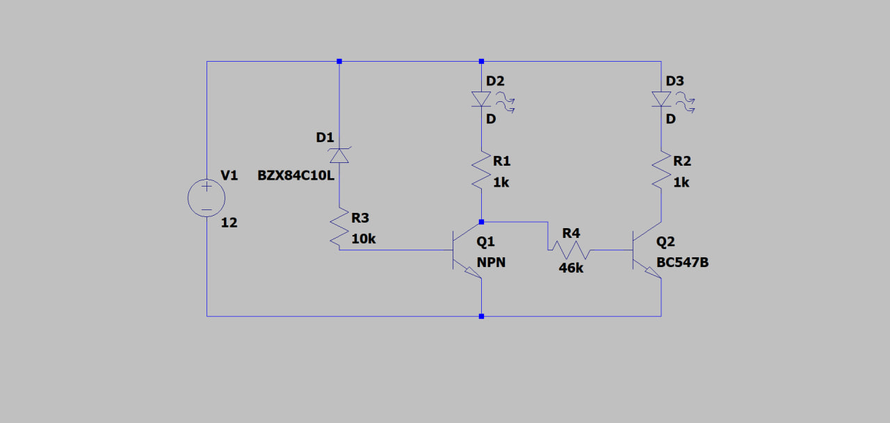

# Title

## Overview
A lamp manufacturer needs a quick go/no-go test for its 12 V lamps: anything drawing more than 1 A fails. Come up with the lowest-cost circuit that turns on a red LED above that threshold and a green LED below it — essentially a one-point current comparison with a visual output.

## Components

## Circuit Diagram
